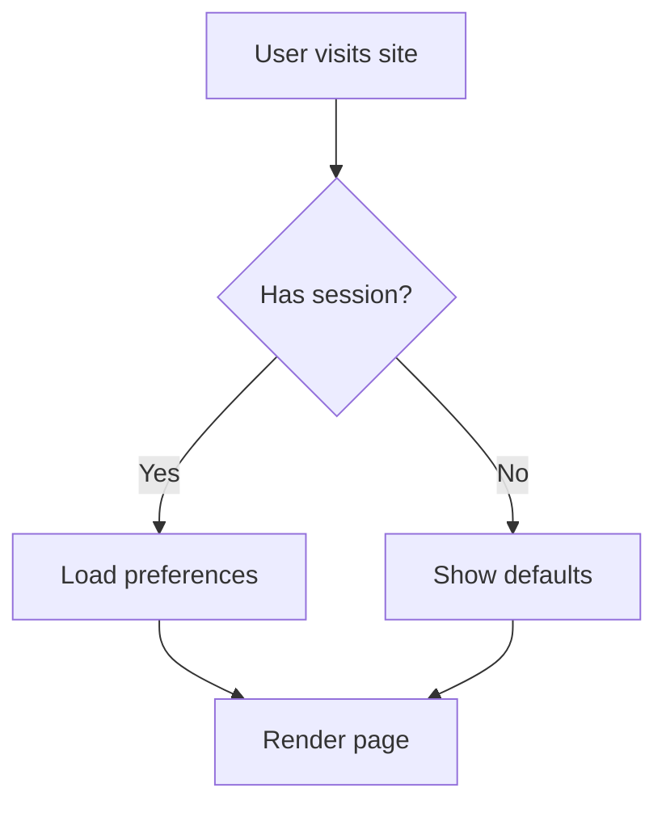
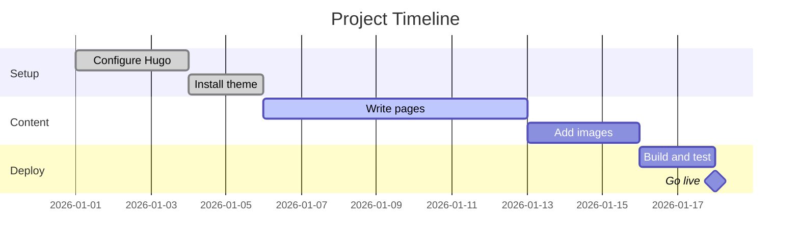
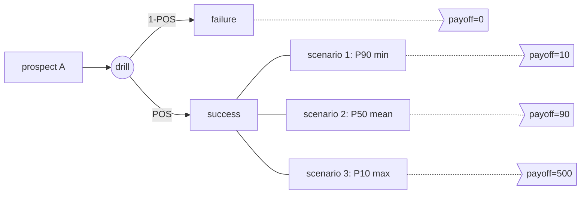
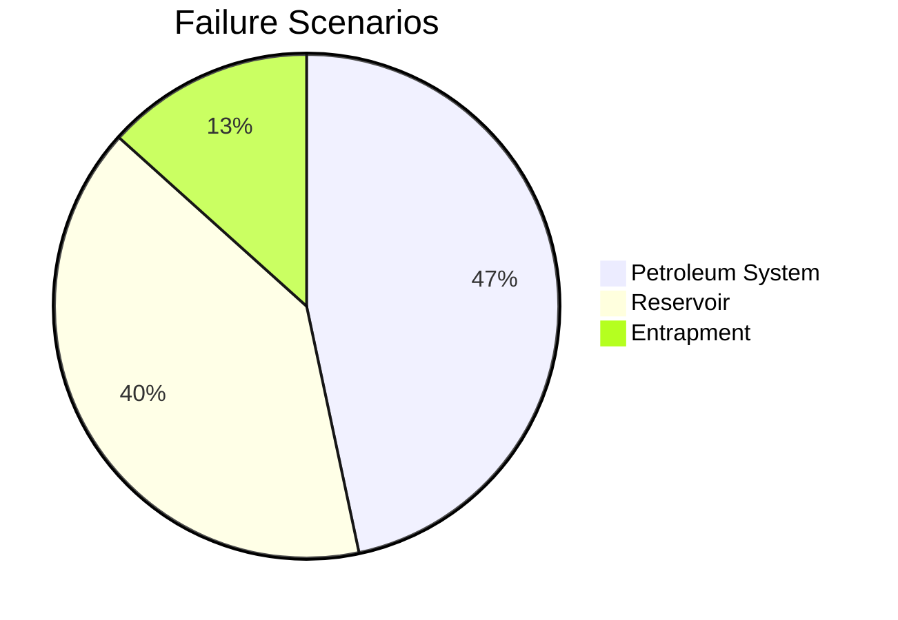

random stuff related to beautifulhugo template 

## callouts

examples following:


This is a **warning** callout.



This is a **danger** callout.



This is a **success** callout.




This is a **note** callout (no title).


## details

for example if you want to hide something now:


This content is hidden by default. You can use **Markdown** here.


### columns

The `columns` and `column` shortcodes create a two-column layout:


Left column content here.

Right column content here.


## figures



`beautifulfigure` shortcode adds PhotoSwipe lightbox support:



captions:




## maths **etc**

The golden ratio is $ \varphi = \frac{1+\sqrt{5}}{2} $

$$
\varphi = \frac{1+\sqrt{5}}{2}
$$

also, mermaid diagrams (I use them for VOI analysis):

this is the code:

```

graph TD
    A[User visits site] --> B{Has session?}
    B -->|Yes| C[Load preferences]
    B -->|No| D[Show defaults]
    C --> E[Render page]
    D --> E

```

this is markdown rendered:



gannts charts with mermaid? I didnt know!



another mermaid example:



pie charts too!



## things I may need

for example this raw code to center images (thinking about screenshots, instructions etc):

```

<em class="caption">A centered image with a caption</em>
```

full width images:

```

```


## gfm syntax

to do list:

- [ ] one
- [x] two checked
- [ ] etc


* bullet 1
* bullet 2
    - subbullet 2a
    - subbullet 2b
